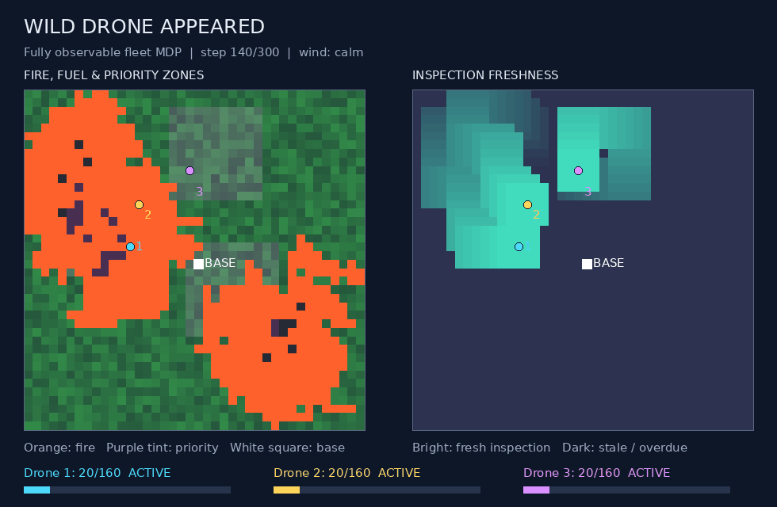

# Wild Drone Appeared

**Coordinated wildfire inspection with a battery-constrained drone fleet.**

One central controller manages three drones in a **fully observable MDP**. The complete fire,
fuel, terrain, wind, inspection-age, drone and charging state is available. Visits deliver
fresh close-range inspections of known hazards; the task is sustained inspection and
recharge coordination, rather than discovering an unknown fire map.

This implements the approved Group 7 project, with resumable CPU/CUDA training and a Colab
experiment workflow. Simulator mechanics, baseline comparisons and all three RL pipelines
are implemented. Validation pilots remain weaker than the greedy controller; **successful
learning and an RL advantage have not been demonstrated**.
Grid sizes and every fire/energy parameter are illustrative, uncalibrated simulation settings.



## Run a visual mission

Python 3.11+ is required; Python 3.12 is used in CI. From the repository root:

```bash
python -m venv .venv
# macOS / Linux
source .venv/bin/activate
# Windows PowerShell: .venv\Scripts\Activate.ps1
python -m pip install -e '.[dev]'
python -m wild_drone demo --config configs/main.json --policy greedy --out runs/demo
```

Open `runs/demo/demo.gif`. It displays fire/fuel/priority zones, inspection freshness, wind,
drone positions and battery levels. `evaluation.csv` and `metadata.json` accompany the demo.
Policies `sweep`, `random` and `planner` are also available. The planner is substantially
slower; use a shorter horizon for a quick check.

## Train and compare the three methods

Install PyTorch first (the following CPU command is sufficient for the starting experiments),
then install the RL extra. A compatible GPU build can be selected from the
[official PyTorch installer](https://pytorch.org/get-started/locally/). Use `--device cpu`,
`--device cuda` or `--device auto`. The NumPy simulator runs on CPU; benchmark the training
runtime before assuming GPU acceleration helps this small network.

```bash
python -m pip install torch==2.5.1 --index-url https://download.pytorch.org/whl/cpu
python -m pip install -e '.[rl,dev]'
python -m wild_drone train --config configs/development.json --algorithm dqn --seed 0 --out runs/dqn
python -m wild_drone evaluate --checkpoint runs/dqn/policy.pt --scenario-seeds 10000 10001 10002 --out runs/dqn-eval
```

Use `--algorithm reinforce` or `--algorithm a2c` to train the other methods. Each controls the
entire three-drone fleet. Checkpoints include the complete environment/training configuration.
Checkpoint evaluation requires the same config; cross-domain battery/fire interventions and
transfer across grid sizes are future experiment work, not silently supported evaluation.

| Method | Family | Implemented update |
|---|---|---|
| DQN | Deep value-based | Replay, target network, joint-action TD values |
| REINFORCE | Monte Carlo policy gradient | Complete episode returns, learned Monte Carlo baseline |
| A2C | Actor–critic | n-step bootstrap, shared actor/value encoder |

The A2C implementation is a synchronous, single-environment n-step advantage actor–critic.
It does not use asynchronous workers. All three are model-free; actor–critic also belongs
to the broad policy-gradient family. Full-grid convolutional input and 125 joint actions are
shared across methods. Version 2 adds three live-drone location channels and one base channel
to the five environmental maps, all derived from the existing complete state. REINFORCE uses
an optional value baseline trained on full Monte Carlo returns, without TD bootstrap. Disable
these choices with `--no-spatial-encoding` and `--no-monte-carlo-baseline` for ablations.
There is no learned-policy action mask or safety shield.
Use `--double-dqn` to select next actions with the online network and evaluate them
with the target network. Standard DQN remains the default. Both variants use the same
replay, network and reward; this flag does not apply to the actor methods. Resume rejects
switching the target rule. `--learning-rate` overrides the configured rate.
REINFORCE weights reward-to-go by absolute-time discount and uses a fixed mission-horizon
normaliser; A2C also uses absolute-time weights with its rollout-length normaliser. The
configurable entropy term is a local policy regulariser, separate from mission reward.

An end-to-end **smoke check** (tiny task and deliberately insufficient training):

```bash
python -m wild_drone compare --grid 8 --horizon 12 --episodes 2 --training-seeds 0 1 --scenario-seeds 10000 10001 --warmup-steps 4 --batch-size 4 --planner-horizon 2 --planner-candidates 3 --planner-samples 1 --out runs/smoke
python -m wild_drone plot --csv runs/smoke/comparison.csv --out runs/smoke/comparison.png
```

For development experiments:

```bash
python -m wild_drone compare --config configs/development.json --training-seeds 0 1 2 --scenario-seeds 10000 10001 10002 --out runs/development
```

Start with 20x20. The main config is 40x40; a 60x60 evaluation should follow only after a
learning/runtime pilot. The main config's 200 episodes is a starting budget, not a justified
convergence threshold. Tune budgets and hyperparameters using separate validation seeds
(e.g. 5000–5999), freeze the choices, then use final test seeds (e.g. 10000+). The CLI rejects
evaluation seeds that overlap training scenarios; it cannot detect manual reuse of test results
for tuning. No long experiment is launched automatically by installing or running tests.

## Resumable validation and Colab

Open [the Colab experiment notebook](notebooks/colab_experiments.ipynb) in Colab (File → Open
notebook → GitHub, or download and upload it). Select a GPU runtime (T4 is sufficient) and run sections 1–6,
then section 8. The notebook handles the private repo with transient hidden credential entry,
benchmarks CPU/CUDA, saves to Drive and runs 1,000 episodes per method for three training seeds.
The optional 40x40 run is disabled until the 20x20 results have been assessed. Send the downloaded
`wild-drone-results.zip` for analysis; checkpoints remain in Drive by default.
The completed T4 study and failure diagnosis are in [the 1,000-episode report](docs/colab1000-results.md).
See [the dated experiment folder](docs/experiments/colab-2026-10-03/README.md) for the
original ZIP, extracted-results and executed-notebook upload paths. Future runs show live
progress and stop their training child when the cell is interrupted.

A bounded local repeated-seed validation study:

```bash
python scripts/run_validation_pilot.py --config configs/development.json --episodes 200 --training-seeds 0 1 2 --device cpu --out runs/validation20
```

Rerun the same command to resume. To extend it, increase `--episodes` (the **total** budget).
The script evaluates final and best-validation policies on seeds 5000–5004, with learning
curves and per-scenario CSVs. Its best score is selection-biased validation evidence, not a
held-out final result. See [the pilot report](docs/learning-pilot.md) for observed failures.

For one method:

```bash
python -m wild_drone train --config configs/development.json --algorithm a2c --episodes 200 --validation-seeds 5000 5001 5002 5003 5004 --checkpoint-interval 20 --validation-interval 20 --device auto --out runs/a2c
python -m wild_drone train --config configs/development.json --algorithm a2c --episodes 400 --validation-seeds 5000 5001 5002 5003 5004 --checkpoint-interval 20 --validation-interval 20 --device auto --resume runs/a2c/training_state.pt --out runs/a2c
python -m wild_drone plot-learning --csv runs/a2c/training.csv --out runs/a2c/learning.png
```

`training_state.pt` restores model/target, Adam, DQN replay, RNGs and metrics at a complete
episode boundary. Files are replaced atomically; the authoritative state is committed before
regenerable exports, so an interrupted first save can restart or resume safely. Work since the last checkpoint
may be lost. Changing learning or environment settings requires a new output folder; resume
allows total episodes, device, checkpoint frequency and progress frequency to change.
Do not run two writers into the same folder. CPU resumption is tested against uninterrupted
training; equality across devices or PyTorch versions is not promised.

`policy.pt` is the final policy; `best_policy.pt` is selected by maximum mean validation return.
Keep both. Original version-1 policies remain loadable, but their files do not contain enough
state to resume training. Source/runtime histories are recorded on resume. Only after freezing
the validation protocol, use `compare --checkpoint-selection best --validation-seeds ...`
on separate final scenarios; `compare` rejects training/validation/test overlaps.

Training completion verifies each exported episode, metadata field and model tensor against
`training_state.pt`, then writes `checkpoint_manifest.json` with hashes of the audited bytes.
The Colab download cell repeats this check immediately before archiving. To audit existing runs:

```bash
python scripts/audit_checkpoints.py runs/validation20/dqn/seed-0
```

An audit failure stops evaluation/archiving; it does not silently repair a file. Explicit
same-budget resume regenerates portable exports from authority. For a completed Drive run,
the following recovery cell uses the saved conditions and performs no new training episodes:

```python
from dataclasses import replace
from pathlib import Path
import torch
from wild_drone.config import EnvConfig
from wild_drone.learning import TrainConfig, train

run = Path('/content/drive/MyDrive/wild-drone-appeared/validation20-v2/reinforce/seed-1')
state = torch.load(run/'training_state.pt', map_location='cpu', weights_only=True)
settings = replace(TrainConfig(**state['train_config']),
                   episodes=state['completed_episodes'], device='cpu')
train(state['algorithm'], EnvConfig(**state['env_config']), settings, run,
      resume_from=run/'training_state.pt')
```

Keep the original archive as a historical record. A standalone portable policy without its
training state can still be loaded, but cannot certify that it is the latest training export.
Hashes certify a snapshot; rerun the audit after copying or synchronizing files.

A matched validation-only DQN/Double DQN screen at the lower rate:

```bash
python scripts/run_validation_pilot.py --episodes 200 --training-seeds 0 1 2 --algorithms dqn --learning-rate 0.00003 --no-double-dqn --out runs/dqn-stability-v3/standard
python scripts/run_validation_pilot.py --episodes 200 --training-seeds 0 1 2 --algorithms dqn --learning-rate 0.00003 --double-dqn --out runs/dqn-stability-v3/double
python scripts/diagnose_dqn.py runs/dqn-stability-v3/standard/dqn/seed-* runs/dqn-stability-v3/double/dqn/seed-* --out runs/dqn-stability-v3/diagnostics.csv
```

The [fixed pilot plan](docs/dqn-stability-plan.md) describes the comparison and its limits.
The [completed six-fit report](docs/experiments/dqn-stability-2026-10-03/README.md) records
poor mission performance despite no observed Q-bound violations in the short replay.
Use separate output folders for variants; all study runners audit completed exports through
`train` before evaluating them. Final test scenarios remain outside this tuning workflow.

The [return-behavior and exploration report](docs/experiments/exploration-2026-10-03/README.md)
traces repeated boundary commands and failed battery returns. A matched slower-exploration
screen covered more joint actions but did not improve final coordination. The default
10,000-step decay remains unchanged. Override it with `--epsilon-decay-steps` for an explicitly
declared experiment; resume rejects changing it. The observational diagnostic runner is:

```bash
python scripts/diagnose_behavior.py runs/validation20/dqn/seed-* --out runs/behavior
```

It checks authority first, reports commands/return-energy margins and final replay coverage,
and includes random, sweep, greedy and all-stay diagnostic controls on the same scenarios.
It also writes one example trace, including the terminal transition, without changing policy
actions or live environment randomness. Tracing adds timing overhead; its decision times
must not be used as uninstrumented policy throughput measurements.

A separate [supervised capability probe](docs/experiments/imitation-2026-10-03/README.md)
shows that the unchanged network fits greedy training demonstrations, including return and
charging decisions, but generalizes poorly and loses the fleet during autonomous validation.
Its checkpoints are explicitly supervised logits; they are not plain RL policies or Q values.
The [fixed probe plan](docs/imitation-probe-plan.md) and raw results preserve that distinction.
Run the bounded CPU diagnostic into a fresh folder:

```bash
python scripts/run_imitation_probe.py --out runs/imitation-v5
```

The [matched coverage comparison](docs/experiments/coverage-2026-10-04/README.md) tests
additional teacher trajectories and Greedy labels on learner-generated states at the same
5,000-update budget. Broader teacher data improves held-out decision agreement, while
fleet-return coordination remains unresolved. Both additions are supervised experiments,
with [fixed collection and validation rules](docs/coverage-probe-protocol.md):

```bash
python scripts/run_coverage_probe.py --out runs/coverage-v6
```

The [fixed-corpus budget study](docs/experiments/fitting-budget-2026-10-04/README.md)
extends fitting to 20,000 updates. Training agreement improves, but all 15 final validation
flights still lose the fleet; the learned controller also fails on familiar training worlds.
More fitting alone has not produced reliable return and recharge behavior. The
[declared comparison](docs/fitting-budget-protocol.md) keeps the network and physics fixed:

```bash
python scripts/run_fitting_budget_probe.py --out runs/fitting-budget-v7
```

## Baselines and fair evaluation

| Baseline | Behaviour |
|---|---|
| Random | Uniform joint commands; a sanity check without a battery-return rule |
| Sweep | Partitioned serpentine patrol with recharge and return heuristics |
| Greedy | Jointly maximises immediate priority/inspection-age gain |
| Planner | Bounded rolling-horizon stochastic shooting with replanning |

Greedy/sweep/planner use explicit battery-aware proposal rules. These are part of their
controllers, not a universal safety guarantee or a shield supplied to RL. The planner knows
the simulator kernel but uses independent hypothetical futures, never the live RNG stream.
Its default budget is horizon 4, eight candidates, two samples; tune it fairly and report
decision time. It is an approximate planner, not an optimal baseline.

CSV reports mission return, priority-weighted freshness, overdue fraction, energy, losses,
safe returns, completed charges, blocked collision attempts and decision time. If every drone
is lost, the remaining mission counts as unserved and its overdue cost is charged. Quality
metrics use the whole mission horizon, including that remainder. An episode does **not**
finish merely because the current fire burns out: priority-area inspection continues.

Compare on identical held-out scenario seeds. Each scenario regenerates whole fuel, priority,
ignition and wind conditions. Repeat training with multiple seeds; retain per-seed rows.
Plots aggregate each fitted model over scenarios before showing variation across training
seeds. Baseline variation is across scenarios. Error bars are sample SD, not confidence
intervals or significance tests. Baseline and RL rewards can differ substantially in short
runs; pilot results must not be treated as scientific findings.

## Project structure and checks

```text
src/wild_drone/     environment, controllers, learning, CLI, rendering and experiments
configs/           versioned development and main settings
tests/             physical accounting, MDP contract, planner and learning checks
notebooks/         project walkthrough, demo, training and comparison commands
docs/              design, implementation plan and references
runs/              ignored local GIFs, CSVs, metadata and checkpoints
```

```bash
python -m pytest -q
python -m ruff check src tests scripts
```

See [design](docs/design.md) for transition order, observation schema and reward semantics,
and [references](docs/references.md) for technical foundations. Before assignment conclusions
or paper claims, complete longer learning pilots, independent validation/tuning, repeated
held-out evaluation, reward/constraint ablations and simulator sensitivity checks. RL's
advantage and publication novelty remain questions to investigate.
