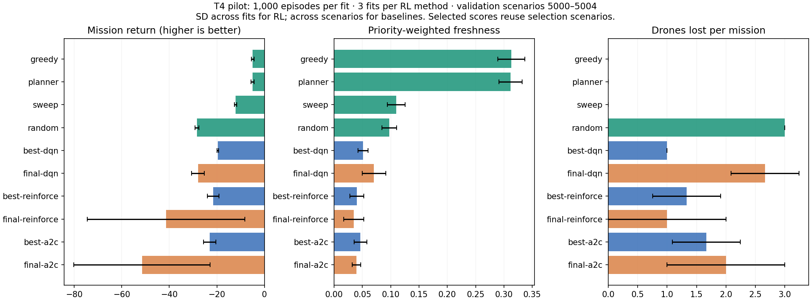

# Completed T4 pilot: execution works, coordinated learning remains weak

All nine 20×20 fits completed 1,000 episodes. The original notebook's study subprocess
returned exit code 0. The archive contains 9,000 training rows, 2,250 periodic validation
rows and 110 final/selected/baseline comparison rows. The optional 40×40 run stayed disabled.
The T4 successfully ran the workload, but none of the learned policies outperformed greedy
or sweep on these validation scenarios. Longer training has not solved recharge coordination.

## Run and provenance

- Original source: `93716b264ad568c0a7c9c754f140f4969880d8ba`, recorded clean.
- Python 3.13.15, PyTorch 2.11.0+cu130, NumPy 2.1.3, Tesla T4, device `cuda`.
- Development environment: 20×20, horizon 160, battery 80, three drones, 125 joint actions.
- Independent network/training seeds 0, 1, 2; the same training scenarios 0–999 for each fit.
- Validation scenarios 5000–5004 every 20 episodes, 50 selection boundaries per fit.
- Both final and maximum-mean-validation checkpoints retained. Planner budget: horizon 3,
  eight candidates, two independently simulated samples.
- Spatial location channels and REINFORCE's Monte Carlo baseline enabled; reward and
  physical rules unchanged. Learned controllers have no battery shield or action mask.

The executed notebook predates the kernel-import fix in PR #3 and used the manual source-path
activation in its benchmark cell. Its metadata identifies the actual learning-code revision;
replacing its outputs with the updated notebook would lose that execution record.
The notebook's install/check cell returned successfully, but its child pytest output/counts
were not saved. CUDA training itself is confirmed by all nine run metadata records.

[Upload destinations and archive checksums](experiments/colab-2026-10-03/README.md) preserve
this dated experiment separately from future studies. The owner uploads the raw ZIP,
extracted files and executed notebook; derived analysis is committed here.

## Validation results

| Policy | Return mean ± SD | Freshness | Drone losses | Blocked attempts |
|---|---:|---:|---:|---:|
| random | −28.337 ± 0.797 | 0.097 | 3.00 | 2.6 |
| sweep | −12.142 ± 0.499 | 0.110 | 0.00 | 0.0 |
| greedy | −4.922 ± 0.588 | 0.313 | 0.00 | 0.0 |
| planner | −5.024 ± 0.656 | 0.312 | 0.00 | 0.0 |
| final DQN | −27.944 ± 2.662 | 0.070 | 2.67 | 4.5 |
| selected DQN | −19.576 ± 0.282 | 0.051 | 1.00 | 0.0 |
| final REINFORCE | −41.382 ± 33.163 | 0.035 | 1.00 | 106.7 |
| selected REINFORCE | −21.539 ± 2.445 | 0.040 | 1.33 | 0.0 |
| final A2C | −51.528 ± 28.716 | 0.040 | 2.00 | 133.5 |
| selected A2C | −23.026 ± 2.561 | 0.047 | 1.67 | 0.0 |

RL means first average five scenarios per fitted network, then average three fits. RL SD
is across three fits; baseline SD is across five scenarios. These are different uncertainty
units, not confidence intervals. Freshness is priority-weighted and averaged over the complete
mission, including an unserved remainder after fleet loss. Higher return is better.
Selected scores reuse the same scenarios for checkpoint selection and reporting. They are
selection-biased, particularly after searching 50 boundaries; no final-test claims follow.

Selected episode boundaries for seeds 0, 1, 2:

| Method | Seed 0 | Seed 1 | Seed 2 |
|---|---:|---:|---:|
| DQN | 680 | 760 | 180 |
| REINFORCE | 1000 | 60 | 440 |
| A2C | 400 | 640 | 340 |

The last 100 stochastic training episodes still lose approximately all three drones per
mission. REINFORCE and A2C training returns remain near −29, close to random performance.
Several selected deterministic policies obtain a better return by retaining stationary drones
while inspecting very little. Their low loss count is not evidence of effective patrol.

## Checkpoint diagnosis

The 18 final/selected policy files were read from the matching Drive seed folders and loaded
with `weights_only=True`. Each file's saved config, training seed and source history matched
the archive. Checkpoint SHA-256 and selected episode boundaries are retained in
[the diagnostic manifest](experiments/colab-2026-10-03/diagnostic-manifest.json).
CPU replay using PyTorch 2.5.1 reproduced all 90 deterministic RL returns exactly, despite
the runtime difference. This replay is validation diagnosis, not a new independent fit.

**DQN value instability:** the maximum predicted Q over each selected policy's validation
trajectories was 73,980.56, 7,916.49 and 3,422.39 for seeds 0, 1, 2. Final maxima were
35,129.54, 9,538.77 and 49,156.47. Under this reward configuration, per-step reward cannot
exceed 1: inspection gain is normalised by total priority, while all other terms are
nonpositive. Therefore true remaining discounted return is bounded above by
`(1 − gamma**remaining_steps) / (1 − gamma)`, at most 79.97 for horizon 160 and gamma 0.99.
These large positive predictions establish value-estimation instability, including at the
selected checkpoints; a good-looking selected return does not establish stable DQN learning.
The median logged DQN loss over the last 100 episodes was 619.36, 33.54 and 778.61,
versus 2.07, 1.31 and 1.04 over the first 100.

**Argmax actor behaviour:** selected REINFORCE uses its dominant joint action for 89.3%
of mission steps on average; selected A2C uses it for 98.6%. Mean joint-action entropy is
3.81 and 4.09 nats, respectively (uniform over 125 actions is 4.83). Thus repetitive argmax
commands do not imply that the stochastic distribution has concentrated on one action.
Final REINFORCE seed 1 and A2C seed 1 each accumulate 320 blocked proposals per mission.

As a separately declared diagnostic, evaluate the **same actor checkpoints** by categorical
sampling, using three fixed action-sampling repetitions per scenario, without training or
changing reward/safety rules. NumPy categorical sampling uses seed
`100000 + 100*scenario_seed + repetition`. Average repetitions and scenarios within each fit
before computing SD across fits. This does not replace the original deterministic comparison.

| Actor checkpoint | Sampled return mean ± fit SD | Freshness | Drone losses |
|---|---:|---:|---:|
| selected REINFORCE | −28.548 ± 0.162 | 0.093 | 3.00 |
| final REINFORCE | −28.472 ± 0.076 | 0.096 | 3.00 |
| selected A2C | −28.810 ± 0.169 | 0.085 | 3.00 |
| final A2C | −29.020 ± 0.235 | 0.085 | 3.00 |

Sampling removes most repeated blocked actions but still loses all three drones in every
sampled mission. Changing only evaluation from argmax to sampling does not recover learned
recharge coordination. All 270 diagnostic missions use validation scenarios 5000–5004.
Raw diagnostic rows preserve both modes, action counts, entropy and Q bound violations.

## Runtime and workflow

Recorded cumulative training/periodic-validation/checkpoint time: DQN 52.96 minutes,
REINFORCE 30.52, A2C 28.04; total 111.52 minutes. This excludes root baseline/final evaluations,
setup and plotting, so it is not the notebook's complete wall time.
The five-episode benchmark measured CPU/CUDA steps per second as DQN 88.45/106.22,
REINFORCE 352.53/189.81 and A2C 326.79/190.87. It is a short runtime probe, not a full-study
prediction. There is no measured A100 comparison.

The reusable notebook now streams stdout/stderr into cell output using unbuffered Python.
It displays each existing 20-episode progress message. Stopping the cell terminates and reaps
the training child, escalating to kill if needed, before returning; the next run resumes from
the last atomic checkpoint. Tests use real children to check delivery before child exit,
nonzero exit propagation, stderr, interruption and a child that ignores termination.
This change does not alter model updates or the completed experiment.

## Continued work: controlled DQN learning-rate screen

After diagnosing the T4 checkpoints, run a bounded CPU screen on unchanged learning code:
200 episodes, training seed 0, the same environment/scenarios/validation intervals,
and learning rates 0.0003, 0.0001 and 0.00003. All settings except learning rate match
within this screen. This is one fitted network per rate, not repeated-fit evidence; it
uses a different runtime from Colab and cannot isolate a GPU effect.

| Learning rate | Selected episode | Selected return | Final return | Maximum final Q |
|---|---:|---:|---:|---:|
| 0.0003 | 100 | −24.398 | −83.764 | 14,419.00 |
| 0.0001 | 40 | −20.069 | −65.311 | 444.79 |
| 0.00003 | 200 | −27.769 | −27.769 | −0.60 |

Maxima are over Q outputs along final-policy validation trajectories. The lowest rate
does not show the excessive positive values seen in the other two fits at this boundary,
but this check alone cannot establish value accuracy or sustained stability. Its final
freshness is only 0.081 and mean drone loss is 2.6. Lowering the rate is a candidate for
further controlled testing, not a demonstrated solution. A small training loss is not
substituted for mission quality.

[Screen CSVs, protocol and runtime metadata](experiments/dqn-rate-probe-2026-10-03/README.md)
preserve all three trials, including the poor control and final policies. Metadata records
a dirty checkout because report/notebook changes were present; the learner remained identical
to merged revision `a9108df`, with its file hash recorded separately. There are no binary
checkpoints in Git.

Continue with longer repeated-seed stability checks and actor learning/entropy diagnostics
on validation before scaling to 40×40. A new learning setting needs a new output folder;
the old 1,000-episode states cannot resume with a changed rate. Keep this original run intact.
No further user GPU run is requested from this screen yet. Final 20×20 scenarios 10000+
remain unused, and final generalisation, RL superiority and simulator calibration remain open.
