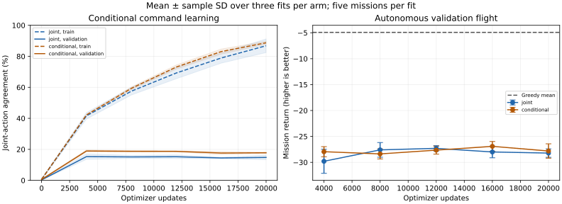
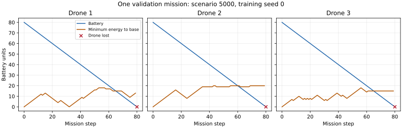

# Conditional action learning: completed diagnostic

The fixed final 20,000-update comparison returns -28.213 ± 0.816 for
the original joint head and -27.811 ± 1.385 for the conditional head.
Whole-fleet losses are 15/15 and
15/15 missions respectively. These are autonomous
learners; no teacher or action override runs during the flights. The conditional recipe
modestly improves label fitting and mean return, but does not establish useful autonomous
competence. It is retained as a diagnostic and is not promoted into RL defaults or scaled.

## Comparison and competence gate

The [predeclared protocol](../../action-protocol.md) changes the output-head recipe while
retaining the original observation transform, nine map channels, 24-value vector,
convolutional body and 128-unit encoder. Within each seed, initial encoder tensors and
training sampler seeds match. The `joint` arm is the exact original FleetNetwork with one
125-way head, 127,677 parameters. The `conditional` arm models
p(a0|state), p(a1|state,a0), p(a2|state,a0,a1) in fixed drone order 0/1/2. Its first head is
linear 128→5; later heads concatenate preceding command one-hots with encoder features,
then use a 64-unit ReLU layer and five logits. It has 130,319
parameters. Head initialization, depth and parameter count differ; this is a complete
recipe comparison, not an equal-capacity factorization ablation. Unused original-head
parameters are removed. Neither representation, reward nor environment physics changes.

Conditional fitting minimizes the sum of three cross-entropies using preceding teacher
commands from the same labeled joint action. This is complete joint negative log
likelihood, without division by three. Deployment enumerates every combination and
chooses global argmax of summed conditional log probabilities. These commands form one
simultaneous fleet action; the factorization does not introduce extra simulator steps.
No sequential greedy decoder, feasibility filtering, safety override, privileged state
or teacher execution is added. Tests verify normalized probabilities, complete action
ordering, joint-MAP behavior and equality of sparse teacher-context/full-joint loss and
gradients. The original-head fitter matches the existing fixed fitter on a same-runtime
small test. This diagnostic is supervised imitation, not an RL advantage.

Before the larger study, both arms fit only world 0 (160 Greedy states), with three seeds,
2,000 updates each and unchanged 20×20 physics. All six fits reach 100% training joint
agreement and exactly reproduce Greedy's training-world flight: return −5.0201, freshness
0.3042, zero drone losses, three safe returns and three completed charges. All seven
training-world flights and 65 validation flights are preserved separately under `sanity/`.
Both arms' 15 final validation flights lose the fleet. The gate establishes known-trajectory
competence only; its success does not establish transfer or unseen-state recovery. No
successful world or checkpoint was selected after seeing outcomes. This gate was fixed
before fitting, and the broader comparison started only after it passed.

The larger study gives all six fits the same 15,864 real teacher states from worlds 0–99
and 800 teacher validation states on worlds 5000–5004. Both semantic dataset identities
match prior full-corpus studies. Keep Greedy's failures and all labels; do not manufacture
successful transitions. Six fits use seeds 0/1/2, Adam 0.001, uniform batch 64 with replacement,
norm clip 0.5, five continuous rounds of 4,000 updates. No curriculum, recovery collection,
class weighting or new inputs belong to this arm comparison. Physics remain 20×20,
horizon 160, three drones and one charger. Final worlds 10000+ remain unused.

## Autonomous missions and teacher decisions

Each fit averages its five missions before mean/sample SD over three fits. Checkpoints
within a fit are nested, not independent fitted models. Whole-fleet losses count all
three drones lost. Greedy is a shared five-world reference with scenario SD, a different
unit. Reused development validation supports exploratory tuning, not final generalization,
significance or a universal claim about conditional heads.

| Updates | Joint return ± fit SD | Conditional return ± fit SD | Joint fleet losses | Conditional fleet losses |
|---|---:|---:|---:|---:|
| 4,000 | -29.795 ± 2.325 | -27.949 ± 0.974 | 15/15 | 15/15 |
| 8,000 | -27.595 ± 1.418 | -28.372 ± 0.973 | 15/15 | 15/15 |
| 12,000 | -27.302 ± 0.518 | -27.647 ± 0.763 | 15/15 | 15/15 |
| 16,000 | -27.998 ± 1.123 | -26.913 ± 0.936 | 15/15 | 14/15 |
| 20,000 | -28.213 ± 0.816 | -27.811 ± 1.385 | 15/15 | 15/15 |
| Agreement-selected | -29.818 ± 2.378 | -27.803 ± 1.032 | 15/15 | 15/15 |
| Greedy reference | -4.922 ± 0.588 (scenario SD) | Shared reference | 0/5 | Shared reference |

The paired final conditional-minus-joint return difference is
0.402 ± 1.979 over three seed pairs. Intermediate budget
results remain measurements, not retrospectively validated best controllers.

| Final autonomous metric | Joint | Conditional | Greedy |
|---|---:|---:|---:|
| weighted freshness | 0.1028 | 0.1154 | 0.3131 |
| total losses | 3.0000 | 3.0000 | 0.0000 |
| safe returns | 0.4667 | 0.5333 | 3.2000 |
| charge completions | 0.0667 | 0.1333 | 3.2000 |
| critical return move fraction | 0.2780 | 0.2071 | 1.0000 |

Actual critical return-move fractions pool opportunities within each fit before averaging
fits; the Greedy fraction pools its five worlds. They measure distance-reducing executed
motion, including blocking effects, separately from teacher-state proposals:

| Final teacher-state metric | Joint | Conditional |
|---|---:|---:|
| train joint accuracy | 86.82% | 88.74% |
| validation joint accuracy | 14.79% | 17.79% |
| validation live command accuracy | 44.08% | 47.08% |
| validation critical command accuracy | 35.82% | 36.82% |
| validation critical toward base command fraction | 46.02% | 49.50% |
| validation charging hold fraction | 90.64% | 96.99% |

Teacher agreement targets one heuristic label including ties; it is not reward optimality.
Both arms use the same dataset here. Selected rounds are [1, 2, 5]
for joint and [3, 3, 1] for conditional, maximizing validation
joint agreement over trained rounds 1–5 with earliest ties and initialization ineligible.
Selection never uses autonomous return and remains biased by repeated validation.

## Decision and next correction

At 20,000 updates, training joint agreement is
86.8% versus
88.7%;
validation agreement is
14.8% versus
17.8%.
Changing how simultaneous commands are modeled is insufficient under this fixed recipe.
The small mean-return difference varies across seed pairs; it does not establish a reliable
advantage. Both final and agreement-selected arms lose every fleet. Conditional flights
complete only 0.133 charges per mission,
versus 3.2 for Greedy, and execute a smaller
critical distance-reducing move fraction than the joint arm despite better agreement on
teacher-state return proposals. Better teacher-state classification does not ensure safe
behavior on the states the learner reaches.

The next correction should isolate return-and-recharge generalization in a small task,
with separately held-out drone/base positions and battery levels, before combining it with
inspection and fleet coordination. A local, drone-centered representation is a testable
candidate, not a demonstrated cause or fix. Require autonomous return and completed
recharge across those held-out configurations, then useful full-fleet inspection, before
spending more on data, training duration or the 40×40 main experiment. The observation
contains the required positions and energy; these results do not identify a unique reason
why the network fails to use them reliably. No new Colab GPU run is needed for this decision.





The example is fixed by runner order and includes the terminal transition. Decision times
include recording overhead, not uninstrumented throughput.

## Integrity and reproduction

```bash
python scripts/run_action_probe.py --training-scenarios 0 --budgets 2000 --updates-per-round 2000 --out runs/action-sanity-v11
python docs/experiments/action-2026-10-04/sanity/check-trained-world.py
python scripts/run_action_probe.py --out runs/action-v11
python docs/experiments/action-2026-10-04/archive-analysis.py
python docs/experiments/action-2026-10-04/replay-results.py runs/action-sanity-v11
python docs/experiments/action-2026-10-04/replay-results.py runs/action-v11
```

Install project/PyTorch dependencies and run from repository root into fresh folders;
there is no resume interface. Replay requires the generated binary datasets/checkpoints
in those run folders; the archive contains their identities rather than their binaries. Python 3.12.14, PyTorch 2.5.1 CPU, NumPy 2.3.5 and one Torch
thread were used. Main fitting, round metrics and persistence total 898.6
seconds across six fits, excluding shared collection and autonomous evaluation. These
instrumented timings are not a throughput benchmark.

Main metadata bind clean source revision `b8f4d2c61cf99e85c1567fbdd3c6571195d94907`;
sanity metadata bind `e7a8931c134d3543f624e2edcd2625d12d1e36c8`. The sole runner change
between them corrects the completion-log word from Representation to Action. Original
runner bytes and a hash/transform audit are preserved under sanity/raw; training and
decoding sources are identical. Protocol source hashes independently bind exact files,
including when publication commits differ. Older trained weights may differ across
host runtimes, so historical fits are not current paired replicates.

All 185 main missions, including five baseline rows, are persisted, with 48 checkpoint identities,
two datasets and 72 label rows. Sanity contains 24 checkpoints, two datasets, 24 label rows,
65 validation and seven trained-world missions. Check source, model/shared-encoder,
progress, metadata and data identities; recompute labels and all non-timing mission/trace
fields. Replay verified 4,995 main mission fields and 4,560 main trace fields, plus
1,755 sanity validation fields, 189 training-world fields and 4,560 sanity trace fields.
All 96 label rows were recomputed from the bound checkpoints. Earliest selection and
final export identities are verified. Four ZIP members
preserve original collection CSV bytes. collection-members.json binds members, and
manifest.json binds raw/derived artifacts. archive-analysis.py regenerates numeric
aggregation and the comparison figure. Binary datasets/checkpoints remain ignored;
their byte/semantic hashes preserve provenance. Original RL loaders reject this explicitly
supervised checkpoint format; earlier reports and RL defaults remain intact.
