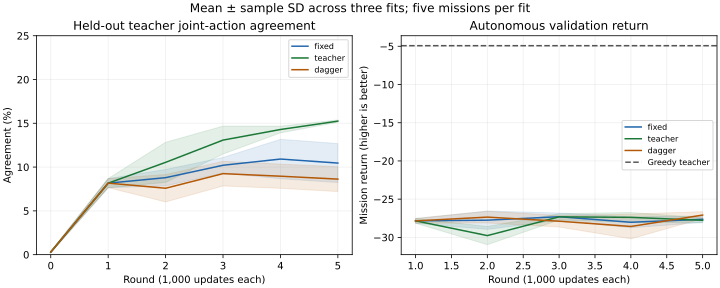
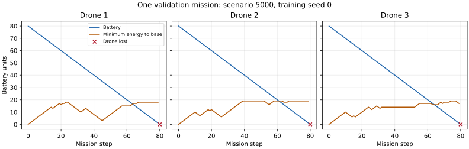

# Coverage and learner-state labeling: completed supervised screen

Broader Greedy trajectories improve held-out teacher-state agreement, but do not produce
useful autonomous coordination at this update budget. Final joint agreement is 10.46% for
the fixed-data control, 15.25% for broader teacher data and 8.62% for learner-state labeling.
44 of 45 final flights lose all three drones; one learner-state flight retains one drone.
All 45 selected flights lose the full fleet. This is supervised imitation, not successful
RL, and does not establish that all dataset aggregation methods or architectures fail.

## Fixed comparison

The [predeclared protocol](../../coverage-probe-protocol.md) keeps the 20×20 development
simulator, 160-step horizon, full observation transform, existing FleetNetwork and 125 joint
outputs. All arms share 3,200 initial Greedy-labeled states from scenarios 0–19. Three fit
seeds 0/1/2 each receive five rounds of 1,000 Adam updates, learning rate 0.001, gradient clip
0.5 and batches of 64 sampled uniformly with replacement. Every fit receives 320,000 label
presentations; the optimizer and independent sampler continue across rounds. There is no
weighting, architecture change, shield, battery rescue, reward change or RL fine-tuning.

| Arm | Added trajectories before rounds 2–5 | Final training labels per fit |
|---|---|---|
| fixed | None | 3,200 / 3,200 / 3,200 |
| teacher | Greedy executes scenarios 20–39, 40–59, 60–79, 80–99 | 15,864 / 15,864 / 15,864 |
| dagger | Previous-round learner executes those same batches; Greedy labels visited pre-action states | 10,881 / 10,485 / 10,268 |

Initial and first-round model tensors are identical across arms within each fit seed.
The matched `fixed` arm uses sampling with replacement; it is a new control, not an exact
reproduction of the preceding probe's shuffled-epoch sampling. Previous fits are not pooled
as additional independent models. Added learner missions often terminate early, so matching
updates does not match oracle queries, state coverage or teacher information. The shared
initial data are collected once and reused by all fits.

The aggregation arm is a bounded DAgger variant: after teacher initialization, collection
uses only learner actions (beta zero), retaining all labels and continuing the optimizer.
It does not solve an exact no-regret optimization problem, and no theoretical guarantee is
claimed. [Ross, Gordon and Bagnell (2011)](https://proceedings.mlr.press/v15/ross11a.html) provide
the primary dataset-aggregation motivation.

Metrics use 800 Greedy teacher states on scenarios 5000–5004 after each round and at
initialization. Those labels never enter updates or added trajectory collection. Selection
maximizes validation joint agreement over rounds 1–5, retaining earliest ties. Selected
rounds are 3/4/4 (fixed), 5/5/5 (teacher), and 1/3/4 (dagger). Autonomous evaluation covers
every trained round plus selected checkpoints, with five shared teacher baseline flights:
275 missions. Selected teacher checkpoints have the same tensors as the final models;
they are duplicated records of the same policies, not additional independent fits.
Final test scenarios remain unused; these repeatedly used scenarios support exploratory
validation, not a final generalization claim.

## Teacher-state decisions

Means below are over three fits. Training joint agreement uses each arm's own final dataset;
those training distributions differ and their accuracies are not directly comparable.
Validation uses the same 800 states for every arm.

| Final metric | fixed | teacher | dagger |
|---|---:|---:|---:|
| Training joint agreement | 94.80% | 46.86% | 69.30% |
| Validation joint agreement | 10.46% | 15.25% | 8.62% |
| Validation live-drone command agreement | 39.76% | 44.35% | 39.72% |
| Validation critical-drone command agreement | 30.85% | 29.85% | 32.09% |
| Validation critical command reduces base distance | 44.28% | 42.79% | 43.03% |
| Validation hold at base when needing charge | 75.89% | 93.17% | 77.53% |
| Validation cross-entropy | 15.327 | 4.881 | 8.137 |

Validation contains 134 critical drone states and 488 charging drone states. The critical
subset comprises alive, away-from-base states with battery minus Manhattan return cost
between zero and three move costs. Proposed commands on these teacher states are separate
from executed moves in autonomous flights. Joint labels record one deterministic Greedy
choice; disagreement can include equally good alternatives and is not a reward-optimality test.
An all-stay predictor agrees with 10.0% of validation joint labels. Broader teacher data
improves overall agreement, charging holds and cross-entropy, while critical-return decisions
remain weak. Its lower training agreement is consistent with less fitting of a larger dataset
under the same update budget; this study does not establish convergence or calibrated confidence.



Lines average three fits; shading is sample SD across fits. Each autonomous return first
averages five missions within the fit. The teacher reference is its five-scenario mean.
There is no uncertainty band or performance guarantee for that horizontal reference.

## Autonomous flights

For fitted policies, average scenarios within each fit before computing mean and sample SD
across the three fits. Teacher baseline SD is across five scenarios, a different unit.

| Final policy | Return mean ± fit SD | Freshness mean | Losses mean | Wall commands mean | Collision blocks mean |
|---|---:|---:|---:|---:|---:|
| fixed | −27.635 ± 0.413 | 0.0987 | 3.000 | 43.000 | 1.067 |
| teacher | −27.765 ± 0.319 | 0.0979 | 3.000 | 63.933 | 1.467 |
| dagger | −27.081 ± 0.449 | 0.0975 | 2.933 | 55.867 | 0.133 |
| Greedy baseline | −4.922 ± 0.588 (scenario SD) | 0.3131 | 0.000 | 0.000 | 0.000 |

The paired final-return differences, using the same fit seeds and validation missions, are
−0.130 ± 0.095 for teacher minus fixed and +0.554 ± 0.247 for dagger minus fixed (sample SD
across three seed pairs). The latter is a small measured improvement in return, but still
leaves nearly the whole fleet lost and inspection freshness far below Greedy. It does not
establish a useful controller, an RL advantage or general performance superiority.
Selected returns are −27.765 ± 0.675 (fixed), −27.765 ± 0.319 (teacher), and
−27.450 ± 0.316 (dagger). Selection uses teacher-state agreement, not autonomous return,
and the selected estimates remain biased by reuse of validation scenarios.

Mean within-fit fractions of critical opportunities with an actual distance-reducing return
move are 43.8%, 17.2% and 31.2% for fixed/teacher/dagger, versus the baseline's pooled 100%.
Pool opportunities across a fit's five missions before averaging those three fit ratios.
Mean completed charges are 0, 0 and 0.067 per mission; Greedy completes 3.2. Lower collision
counts or partial survival do not demonstrate sustained inspection/recharge coordination.



The example is chosen by runner order, includes the terminal transition, and shows the
necessary distance-based return-energy bound. Nonnegative margins do not guarantee safety:
hovering and blocked moves can consume more battery. Wall commands are clamped and cost
energy; they differ from collision blocks. Decision times include diagnostic overhead and
are not uninstrumented throughput measurements.

## What the added trajectories contain

Added Greedy trajectories contain 12,664 labels per fit, 2,411 critical and 6,973 charging
drone states. Their datasets and audits are deterministic duplicates across fit seeds,
not independently sampled teacher corpora. They contain 42 unreachable live-drone states
(0.11% of 37,992 live-drone states). Greedy terminates early with full fleet loss on added training scenarios 20 and 98
(step 92 in each), even though it loses no drones on the five validation scenarios.

The three learner collections add 7,681/7,285/7,068 labels. Of their live-drone states,
16.63%/16.18%/15.83% already have negative necessary return margins. Their critical drone-state
counts are 933/1,036/898; charging counts are only 133/60/87, compared with 6,973 in the teacher
collection. These counts exclude the shared initial dataset and describe collection, not
independent experimental trials. No synthetic initial states or post-termination states are used to manufacture recovery
examples; records contain real pre-action states only.

This evidence shows that the tested learner collection supplies few successful charging
examples and many states already below a necessary return bound. It motivates examining
collection quality and fitting budget, but does not isolate either as the cause of failure.
Greedy supplies conventional heuristic labels and can fall back to all-stay when its proposal
set is empty; it is not an optimal recovery oracle. All-stay labels are logged, but those
counts alone do not identify fallback occurrences.

## Integrity and reproduction

```bash
python scripts/run_coverage_probe.py --out runs/coverage-v6
python scripts/plot_return_energy.py --trace runs/coverage-v6/example-trace.csv --protocol runs/coverage-v6/protocol.json --out runs/coverage-v6/return-energy.svg
```

Run from the repository root after installing project/PyTorch dependencies. Use a fresh
folder if the output exists; this diagnostic has no resume interface. Python 3.12.14,
PyTorch 2.5.1 CPU and NumPy 2.3.5 were used with one Torch thread. Fitting, round metrics,
persistence and added collection total 237.7 seconds across nine fits; this excludes shared
initial/validation collection and autonomous evaluation and is not a throughput benchmark.
All fit metadata record clean local source revision `2eece0127de31d4e63e29ec5775d260ff9e328fc`.
The protocol binds exact source hashes independently of the eventual remote commit history.

`raw/` preserves 108 label-metric rows, 275 flight rows, per-fit metadata, dataset/checkpoint
manifests, collection summaries, timing and one full example trace. Seven `collection-records.zip`
files preserve the 26 original collection CSVs without changing their bytes; `collection-members.json`
binds member hashes and locations. `per-fit.csv`, `per-round.csv` and `summary.json` preserve
aggregation; `archive-analysis.py` regenerates these and the comparison chart from raw records.
The archive manifest binds raw and derived artifacts. All 26 binary datasets and 72 checkpoints
remain in ignored local run folders; verified byte/semantic/model hashes stay in the repo.
Initial and first-round tensor identities, selected-round identity, and final-round identity
are checked. The coverage format is explicitly supervised and rejected by ordinary RL loaders.
Earlier experiment records and plain RL defaults are preserved.

Broader teacher coverage improves some held-out decisions but autonomous return coordination
remains unresolved. The next bounded question should test fitting more of this broader corpus
and inspect whether battery-return decisions benefit, before treating demonstration weights as
an RL initialization. Changes to state/action representations or safer collection can then be
explicitly ablated if supervised fitting still fails to produce useful validation flights.
Larger grids or final test reporting would be premature at this stage.
