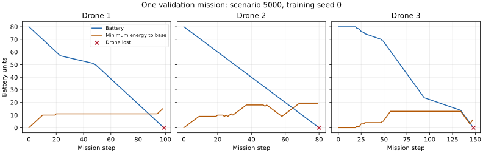

# Return behavior and slower exploration: completed validation screen

Slower uniform exploration broadened replay coverage, but did not produce a useful
controller. Keep the original epsilon schedule. This is a short diagnostic experiment,
not a final generalisation result or a claim that all exploration strategies fail.

The [predeclared plan](../../exploration-plan.md) fixes standard DQN, learning rate
0.00003, 200 episodes, three training seeds 0/1/2, scenarios 0–199 for training,
validation scenarios 5000–5004 every 20 episodes, and unchanged development mechanics.
The sole learning difference is epsilon decay over 10,000 versus 40,000 steps.
Both arms were trained fresh. Neither final test scenarios nor the original T4 archive
were changed or used for tuning in this phase.

## What the behavior trace reveals

Before this experiment, the previous lower-rate DQN/Double DQN exports were replayed
with observational diagnostics: 60 fitted-policy missions plus 20 control missions.
Final DQN averaged 102.6 wall commands per mission; final Double DQN averaged 126.1.
These differ from collision blocks (43.8 and 19.6): boundary commands are clamped
by the kernel and still cost movement energy, but are not counted as collisions.
Repeated unchanged moves are not successful inspection coordination.

A necessary return-energy bound is Manhattan distance to base times move cost.
We classify live, away-from-base states with margin 0 through three move costs as
critical, using a 0.0001 battery-unit tolerance. Negative margins imply insufficient
energy for even the shortest return path. Nonnegative margins do not guarantee safety;
collisions and hovering can consume more. This diagnostic does not intervene in actions.

For the previous final policies, actual distance-reducing moves occurred in 50/226
critical drone steps for DQN and 21/183 for Double DQN. Greedy and sweep moved toward
base in every observed critical drone step. They use explicit battery-aware proposal
rules; these rules are part of their conventional controllers and are not supplied
to RL. The all-stay diagnostic control returned −15.559, lost no drones and inspected
little. Its survival alone is not coordination; it still outscored the final RL policies.



This is the final 10,000-step-decay DQN policy, seed 0, scenario 5000, selected as the
first diagnostic job rather than by inspecting outcomes. Each drone eventually falls
below the necessary return-energy bound and is lost. The CSV records the final loss
transition as well as pre-action states; lost drones are excluded from later live counts.

## Matched experiment results

Average each fitted model over its five scenarios, then compute mean and sample SD
over three fits. Selected checkpoints maximise scenario-mean return over ten validation
boundaries and are biased. Baseline SD is across five scenarios, a different unit.

| Policy | Return mean ± fit SD | Freshness mean | Losses mean | Collision blocks mean | Wall commands mean |
|---|---:|---:|---:|---:|---:|
| Final 10k decay | −38.016 ± 6.901 | 0.0524 | 3.000 | 43.800 | 102.600 |
| Final 40k decay | −37.904 ± 5.019 | 0.0449 | 3.000 | 42.133 | 124.333 |
| Selected 10k decay | −29.333 ± 0.886 | 0.0682 | 3.000 | 3.600 | 126.267 |
| Selected 40k decay | −27.699 ± 3.984 | 0.0656 | 2.533 | 6.000 | 141.267 |

Greedy returned −4.922 ± 0.588 with freshness 0.3131 and no losses. Random returned
−28.337 ± 0.797 with all three drones lost. Every final learned-policy mission in both
arms lost the entire fleet. The 0.112 difference in final mean return does not justify
a performance claim. The selected-policy difference is also insufficient to claim
improvement, particularly after checkpoint selection on these same five scenarios.

The mean per-fit fraction of critical drone steps with an actual distance-reducing
return move was 19.2% for final 10k decay and 14.1% for final 40k decay. For each fit,
this ratio pools opportunities over its five missions; the three fit ratios are then
averaged. This differs from pooling opportunities across every fitted model. Mere
commands toward base can be blocked, so actual and intended counts are both retained.

### Replay coverage and value checks

| Final retained 2,000-transition buffer statistic, mean over fits | 10k decay | 40k decay |
|---|---:|---:|
| Distinct joint-action labels | 103.0 | 125.0 |
| Live pre-state fraction with negative return margin | 17.07% | 14.07% |
| Transitions with a safe return | 17.0 | 32.0 |
| Transitions with battery increase from charging | 5.33 | 11.00 |
| Last action's random-selection probability | 0.050 | 0.519 |
| Schedule-implied expected random fraction over completed steps | 0.269 | 0.760 |

Replay statistics describe the final retained buffer, not complete training history.
Action-label coverage does not imply coverage of coordinated trajectories. Safe-return
and charging counts are transitions containing at least one such event, not drone-event
counts. Expected epsilon selections are calculated probabilities, not observed counts
of random branches. Broader coverage and more return/charging transitions did not
translate into safer deterministic final policies in this experiment.

| Checkpoint group | Maximum visited Q | Upper-bound violations / decisions |
|---|---:|---:|
| Final 10k decay | −0.0083 | 0 / 1,785 |
| Selected 10k decay | 1.0351 | 0 / 1,789 |
| Final 40k decay | 8.2019 | 0 / 1,448 |
| Selected 40k decay | 6.5959 | 11 / 2,046 |

The bound uses the remaining mission horizon and the maximum one-step freshness reward.
Violations in the selected 40k policies occur near the horizon: nine visited states
for seed 0 and two for seed 2. Maximum excess is 1.9945 battery-independent reward units.
These are smaller than the original high-rate T4 Q explosion, but still contradict a
claim of calibrated values. Lack of violations in another group also does not prove
calibration or long-run stability. Selected episodes were 140/120/180 (10k) and
160/100/160 (40k), in seed order.

## Integrity and reproduction

All 12 new exports matched authoritative metadata and exact model tensors. All 60
new fitted-policy diagnostic mission returns, freshness, losses, returns and completed
charges exactly match comparison records. The three fresh 10k controls reproduced
the previous standard-DQN model tensors exactly. The previous controls are retained
as reproducibility evidence and are not counted as additional independent fitted models.

The new runs contain 1,200 training rows, 300 periodic validation rows and two 50-row
comparison files, including duplicated baseline rows. Each diagnostic study contains
80 missions, six final-buffer records and one example trace. `per-fit.csv` aggregates
mission metrics by fit/selection; `summary.json` calculates sample SD with `ddof=1`.
Q maxima/violations aggregate by maximum/sum, and critical-return ratios use the
within-fit opportunity pooling described above. `archive-manifest.json` checksums
46 copied raw, diagnostic, provenance and chart records.

Run from the repository root:

```bash
python scripts/run_validation_pilot.py --episodes 200 --training-seeds 0 1 2 --algorithms dqn --learning-rate 0.00003 --no-double-dqn --epsilon-decay-steps 10000 --out runs/exploration-v4/default
python scripts/run_validation_pilot.py --episodes 200 --training-seeds 0 1 2 --algorithms dqn --learning-rate 0.00003 --no-double-dqn --epsilon-decay-steps 40000 --out runs/exploration-v4/slow
python scripts/diagnose_behavior.py runs/exploration-v4/default/dqn/seed-* runs/exploration-v4/slow/dqn/seed-* --out runs/behavior-v4/exploration
python scripts/plot_return_energy.py --trace runs/behavior-v4/exploration/example-trace.csv --protocol runs/behavior-v4/exploration/protocol.json --out runs/behavior-v4/exploration/return-energy.svg
```

Python 3.12.14, PyTorch 2.5.1 CPU and NumPy 2.3.5 were used. Each process used one
Torch thread; arms ran concurrently in separate folders. Training times total 741.3
seconds across fits, including periodic validation/persistence, and are not a throughput
benchmark. Source hashes match the training files in the final implementation; per-fit
metadata records local revisions `300af7e`/`d33abba` and clean/dirty status during execution.
The launch manifest records the preceding base revision and uncommitted changes at launch.
Binary checkpoints remain under ignored local run folders; the repository contains
verified hashes, CSV/JSON records and the diagram rather than binary training states.

These diagnostics locate recurrent command/energy failures. They do not prove a single
architectural root cause. Rate, target-rule and uniform-exploration tweaks have not
solved coordination in the tested budgets. The next design discussion should compare
explicitly ablated action/value representations or a separately labeled demonstration
warm start, with plain RL controls preserved. A larger grid or final held-out claim
would be premature without a useful, reproducible validation policy.
