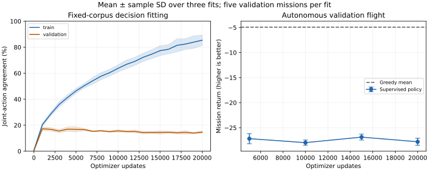
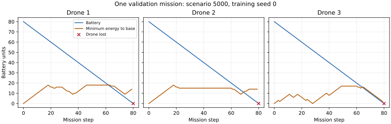

# Fixed-corpus fitting budget: completed supervised diagnostic

Four times as many updates does not fix fleet-return coordination. At 20,000 updates,
all 15 autonomous validation missions lose all three drones, with mean return −27.807
versus Greedy's −4.922. Training joint-action agreement rises from 46.38% to 85.39%,
while validation agreement falls from 16.83% to 14.67%. More fitting of this corpus
improves training decisions without producing a useful autonomous controller.

## Controlled comparison

The [predeclared protocol](../../fitting-budget-protocol.md) supplies the complete Greedy
corpus on training scenarios 0–99 from the first update: 15,864 real pre-action states,
including 3,034 critical and 8,690 charging drone states. Greedy loses the fleet on training
scenarios 20 and 98 at step 92; no battery restoration or post-termination labels are added.
Validation contains 800 Greedy states from scenarios 5000–5004, including 134 critical and
488 charging drone states. Every fit uses the same training and validation datasets.

Three seeds 0/1/2 train the existing FleetNetwork and 125 joint-action outputs, with unchanged
observations, 20×20 development physics and 160-step horizon. Adam uses learning rate 0.001,
batch size 64 sampled uniformly with replacement and gradient norm clip 0.5. Optimizer and
sampler state continue for twenty rounds of 1,000 updates. Budgets 5k/10k/15k/20k are nested
checkpoints of each fit, not twelve independently trained models. No masks, shields, new
collection, weighting, reward change or RL updates are included.

The original agreement-selected exports remain separate: maximum validation joint agreement
among rounds 1–20, earliest ties, initialization ineligible. Selected rounds are 4/1/2 for
seeds 0/1/2. Selection uses teacher-state agreement, not autonomous return. The 5k control
receives all data upfront, unlike the earlier progressive teacher arm; historical fits
are context, not additional matched replicates. Final test scenarios 10000+ remain unused.

## Decisions and autonomous missions

Each fitted policy is evaluated on the same five validation missions. Returns first average
those missions within each fit, then show mean and sample SD over three fits. Greedy's SD
uses five scenarios, a different unit. Loss counts below are missions losing the entire fleet.

| Updates | Training joint agreement | Validation joint agreement | Return mean ± fit SD | Full-fleet losses |
|---|---:|---:|---:|---:|
| 5,000 | 46.38% | 16.83% | −27.186 ± 1.005 | 14/15 |
| 10,000 | 63.76% | 15.62% | −27.981 ± 0.524 | 15/15 |
| 15,000 | 77.36% | 14.38% | −26.877 ± 0.592 | 13/15 |
| 20,000 | 85.39% | 14.67% | −27.807 ± 0.701 | 15/15 |
| Agreement-selected | — | — | −29.752 ± 3.022 | 14/15 |
| Greedy | — | — | −4.922 ± 0.588 (scenario SD) | 0/5 |



Shading/error bars represent sample SD across fits. The Greedy line is a shared scenario
mean without an uncertainty band. These repeatedly used validation scenarios support an
exploratory comparison, not final generalization or significance claims. The paired 20k
minus 5k return difference is −0.621 ± 0.625 over three seed pairs. The small non-monotonic
changes at intermediate budgets do not establish a reliable controller or a best budget.

At 20k, validation critical-command agreement is 31.09%, and only 46.77% of predicted
commands on critical teacher states reduce distance to base. Validation charging holds
are 92.96%, yet autonomous missions complete only 0.267 charges and 0.533 safe returns on
average, versus Greedy's 3.2 each. Freshness is 0.1059 versus 0.3131. Pooling critical
opportunities within each fit, then averaging fit ratios, only 25.80% have an actually
executed return move. A proposed return command can be blocked; these metrics distinguish
teacher-state decisions from autonomous execution.

Training critical-command agreement reaches 93.07% and charging holds 99.90%, but validation
cross-entropy rises from 4.607 at 5k to 13.798 at 20k. The growing fit/validation gap is
consistent with overfitting this corpus. It does not identify a unique cause, establish
convergence, or prove that all imitation methods fail. Greedy is a deterministic heuristic,
not an optimal oracle, and agreement penalizes alternative joint choices too.



This example is fixed by runner order and includes the terminal transition. The Manhattan
return-energy margin is necessary, not sufficient: hovering and blocked commands consume
energy. Wall commands differ from collision blocks. Instrumented decision times include
recording overhead and are not uninstrumented throughput measurements.

## Post-hoc familiar-world diagnostic

After inspecting the declared budget results, final 20k policies were flown on training
scenarios 0–4, with five Greedy reference flights. This is an explicitly post-hoc, overlapping
training diagnostic, separate from the 80 declared validation missions. It updates no models
and does not select a checkpoint. All 15 learned missions lose the entire fleet; mean return
is −27.490, freshness 0.1124 and completed charges 0.067. Greedy loses no drones in these
five worlds, with return −4.988, freshness 0.3081 and 3.0 completed charges.

The failure therefore occurs even on familiar worlds. Accurate decisions along teacher
trajectories do not imply stable autonomous behavior after the learner takes different
actions. This overlap check does not isolate representation, joint-action coupling,
label quality or accumulated decision errors as the cause, and is not held-out evidence.

## Integrity and reproduction

```bash
python scripts/run_fitting_budget_probe.py --out runs/fitting-budget-v7
python docs/experiments/fitting-budget-2026-10-04/replay-diagnostics.py
python docs/experiments/fitting-budget-2026-10-04/archive-analysis.py
```

Install project/PyTorch dependencies and run from the repository root. The first command
requires a fresh output directory; there is no resume interface. The replay helper requires
the matching ignored checkpoints. Python 3.12.14, PyTorch 2.5.1 CPU and NumPy 2.3.5 were used
with one Torch thread. Fit/round-metric/persistence time totals 251.6 seconds across three
fits, excluding shared collection and autonomous evaluation; it is not a throughput benchmark.
All metadata record clean implementation revision `1ca6589420de9d9893345458e16e756c54defefd`.
Exact source hashes bind the run independently of later publication commit identities.

One persistence discrepancy remains documented: the run log reports 80 missions, but the
saved CSV contains the complete 75 learned-policy rows and omits five Greedy rows. The cause
is unresolved. The original CSV and log are archived unchanged. All 75 learned flights were
replayed with exact agreement in every non-timing mission/behavior field. The five declared
baseline flights were replayed into a separate `baseline-replay.csv`; no learned rows were
replaced, and the missing rows were not treated as measured original timing records.
`replay-verification.json` preserves the discrepancy and reconstruction details.

`raw/` contains 126 label-metric rows, 75 original learned validation flight rows, five
baseline replays, 20 post-hoc training-world flights, fit metadata, data/checkpoint manifests,
source hashes, timing and an example trace. Two ZIPs preserve original collection CSV bytes;
`collection-members.json` binds their locations and hashes. `archive-analysis.py` regenerates
numeric summaries and the comparison figure; `archive-manifest.json` binds archived raw and
derived artifacts. Two binary datasets and 69 checkpoints remain in ignored run folders;
verified byte, data and model identities are recorded in the repository. Round/final/selected
identities are checked, and the format remains explicitly supervised, rejected by RL loaders.

More updates alone have failed this test. The next bounded experiment should isolate an
explicit representation of drone-to-base displacement and return-energy margin, while
keeping physics and action authority fixed and comparing against the current input transform.
It should separately report label decisions and autonomous return/recharge behavior. A
supervised RL warm start or larger-grid experiment would be premature without useful flights.
