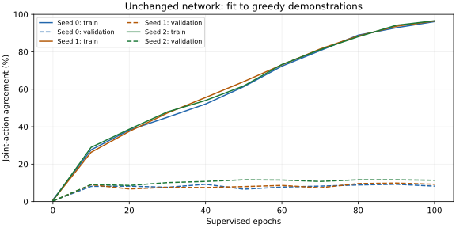
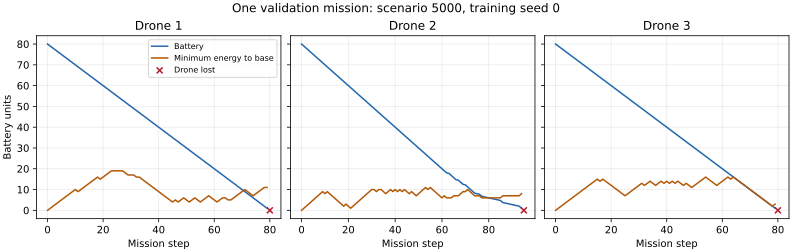

# Greedy imitation capability probe: completed validation diagnostic

The unchanged network fits demonstrated decisions, including battery-return and charging
examples, but does not generalize into a useful controller under this budget. Final models
agree with 96.4% of training joint actions and 9.6% of held-out teacher joint actions.
Every final and selected autonomous validation mission loses all three drones. This is a
supervised diagnostic, not evidence of successful RL, a warm-start experiment, or a proof
that the architecture cannot generalize.

## Fixed protocol

The [predeclared plan](../../imitation-probe-plan.md) uses the unchanged 20×20 development
environment, 160-step horizon, nine spatial channels, 24-vector input, CNN16/32 plus dense128
encoder and 125 joint-action outputs. Collect real GreedyPolicy trajectories on scenarios
0–19 (3,200 states) and 5000–5004 (800 states). All three fits share these datasets and use
seeds 0/1/2, 100 epochs, batch size 64, Adam rate 0.001 and gradient norm clip 0.5.
There are 5,000 optimizer updates per fit. Ordinary cross-entropy uses only training labels.
There is no critical-state oversampling, class weighting, action shield, RL fine-tuning or
change to simulator physics, rewards, RL trainers or defaults. Final test scenarios remain unused.

Validation label metrics are measured every ten epochs. Selected checkpoints maximize
validation joint-action agreement, with the earliest measured epoch retained on ties;
untrained initialization is ineligible. Selected epochs are 40/90/50, with agreement
9.25%/9.875%/11.625%. Their estimates are subject to selection on the same five scenarios.
Each initial, final and selected model independently controls five full validation missions;
the teacher controls five more, totaling 50 missions.

## Fitting and generalization

Numbers below are means over three fits. All teachers remain alive. Training data contain
623 critical drone states and 1,717 charging drone states; validation contains 134 and 488.
Critical means alive and away from base, with battery minus Manhattan return cost between
zero and three move costs. These are observed subset counts, not independently sampled trials.

| Final teacher-state metric | Training | Validation |
|---|---:|---:|
| Exact joint-action agreement | 96.38% | 9.63% |
| Per-live-drone command agreement | 98.39% | 40.10% |
| Critical joint-action agreement | 97.32% | 4.84% |
| Critical per-drone command agreement | 98.66% | 34.83% |
| Critical proposed command reduces base distance | 99.41% | 46.02% |
| Hold command while at base needing charge | 99.84% | 76.64% |
| Cross-entropy | 0.145 | 15.810 |



Training agreement rises while held-out agreement stays low and final cross-entropy is high.
The most common training label is all-stay (action 0): 5.34% of training states and 10.0%
of validation states. Thus a constant all-stay predictor reaches 10.0% joint agreement on
these teacher states, compared with the final models' 9.63% mean. This is a descriptive
label-frequency reference; survival or label agreement alone does not establish coordination.
Training covers all 125 labels, validation 89. Labels record one deterministic greedy choice;
disagreement can include equally good alternatives and is not itself a reward optimality test.

The training return/charging subsets demonstrate that the present network can fit many such
examples under direct supervision. That does not show that the RL objective or its visited
state distribution can learn them. Poor held-out fitting is already present on teacher
trajectories; additional drift when the model controls the fleet could compound failures.
This study does not isolate that drift or prove a single cause. The sequential-distribution
issue is discussed by [Ross, Gordon and Bagnell (2011)](https://proceedings.mlr.press/v15/ross11a.html);
this probe does not implement DAgger.

## Autonomous missions

For fitted policies, first average the five missions for each model, then compute mean and
sample SD over three fits. Baseline SD is over five scenarios, a different unit.

| Policy | Return mean ± fit SD | Freshness mean | Losses mean | Wall commands mean | Collision blocks mean |
|---|---:|---:|---:|---:|---:|
| Untrained network | −39.175 ± 10.413 | 0.0451 | 2.867 | 136.467 | 51.200 |
| Final imitation | −27.461 ± 0.288 | 0.1048 | 3.000 | 37.667 | 1.267 |
| Selected imitation | −28.851 ± 1.361 | 0.1012 | 3.000 | 49.467 | 7.733 |
| Greedy teacher | −4.922 ± 0.588 (scenario SD) | 0.3131 | 0.000 | 0.000 | 0.000 |

Final imitation models execute distance-reducing return moves in 31.7% of critical drone
steps on average across fits; selected models execute 30.7%, versus the teacher's pooled
100%. For each fit, pool opportunities across its five missions before computing the ratio.
These executed-move fractions differ from proposed commands on teacher-generated states.
Final policies average 0.333 safe returns and 0.133 completed charges per mission; the teacher
averages 3.2 of each. All 15 final and all 15 selected missions lose the full fleet.



The example is final seed 0 on scenario 5000, chosen by runner order rather than by its outcome.
The recorded final transition is included. The distance-based energy requirement is necessary,
not sufficient: blocked moves or hovering can consume additional battery. Wall commands are
clamped and consume energy; they differ from collision blocks. Instrumented decision times
include tracing overhead and should not be used as policy throughput benchmarks.

## Records and reproduction

Run from the repository root with the CPU PyTorch and project dependencies installed:

```bash
python scripts/run_imitation_probe.py --out runs/imitation-v5
python scripts/plot_return_energy.py --trace runs/imitation-v5/example-trace.csv --protocol runs/imitation-v5/protocol.json --out runs/imitation-v5/return-energy.svg
```

Use a fresh folder if that output already exists; this diagnostic has no resume interface.
Python 3.12.14, PyTorch 2.5.1 CPU and NumPy 2.3.5 were used with one Torch thread. Fitting,
label evaluation and persistence totaled 69.9 seconds across the three models; this excludes
autonomous mission evaluation and teacher collection and is not a throughput benchmark.
Per-fit metadata records clean local source revision `1770c33dfb41e121541adea7e86c4643aab07fa3`.
Protocol source hashes bind the implementation and predeclared plan independently of git history.

`raw/` preserves 66 label-metric rows, 50 autonomous mission rows, one full example trace,
per-fit metadata, checkpoint manifests and summaries, the root dataset/source protocol and
fit timings. `per-fit.csv` and `summary.json` preserve the aggregation; `archive-analysis.py`
regenerates them and the label plot from archived raw records. `archive-manifest.json` binds
raw and derived artifacts. Binary datasets and nine checkpoints remain in ignored local runs;
byte and semantic dataset hashes, and exact checked checkpoint hashes, are retained in the repo.
Checkpoints use an explicit supervised format and cannot be silently evaluated as DQN policies.

The next useful experiment is a separately declared test of broader demonstration coverage
and labels on states reached by the learner, with this plain imitation result kept as its
control. Compare held-out decision fitting and autonomous coordination before adding an RL
warm start or changing architecture. More GPU time or a larger grid alone is not supported
as a remedy by these results.
