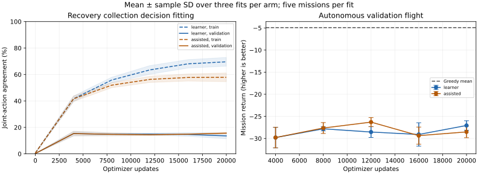
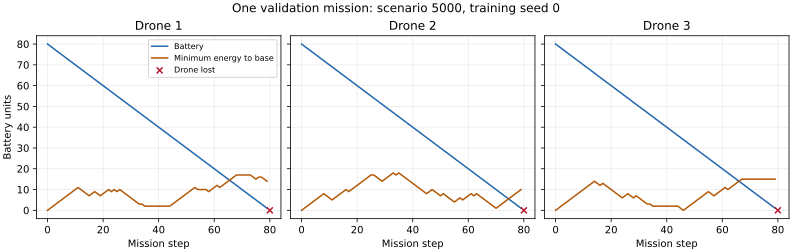

# Teacher-assisted recovery collection: completed diagnostic

The assisted collection recipe changes the experience, but the autonomous improvement
gate remains unmet. At the fixed final 20,000 updates, learner-only collection loses the
whole fleet in 14/15 missions and assisted collection in
15/15. Mean return is
-27.060 ± 1.073 versus -28.515 ± 1.311.
Keep this as a diagnostic; do not promote it into RL defaults or scale the grid/GPU budget.

## Fixed comparison

The [predeclared protocol](../../recovery-protocol.md) retains the original FleetNetwork,
nine map channels, 24 vector values and 125 joint outputs. Six fits use seeds 0/1/2,
the same initial Greedy corpus of 15,864 states from worlds 0–99, and 800 teacher validation
states on worlds 5000–5004. All initial and first-round tensors match within arm pairs.
Adam rate is 0.001, uniform batch size 64 with replacement, norm clip 0.5, five continuous rounds
of 4,000 updates. Environment remains 20×20, horizon 160, three drones, one charger.

Before rounds 2–5, revisit training worlds 0–24, 25–49, 50–74, 75–99 once. Both arms label
every real pre-action state with Greedy and propose actions with the preceding-round
learner. `learner` executes only learner actions. `assisted` executes Greedy whenever
any live drone is away with necessary return-energy margin at most six move costs, or
at base below full charge; otherwise an independent coin chooses teacher with probability 0.5.
Coins are drawn every step from seed 100000+100*fit_seed+round, separately from environment RNG.
Record executed source, both proposals, gates, coins and actual transition events.

Assistance uses a joint action and combines mixture/energy/charging gates; component
effects are not isolated. It cannot rescue physically impossible returns. Keep failures,
duplicate states and all labels. Append to the fixed corpus with uniform sampling.
Updates and world IDs match; label counts, trajectory lengths and teacher queries do not.
Deployment uses a plain argmax learner with no teacher, coin, gate or action intervention.
This is supervised imitation, not an RL result.

## Autonomous outcomes

Average five worlds within each fit, then report mean/sample SD over three fits.
Nested checkpoints are not independent fits. The shared Greedy reference has five worlds
and scenario SD, a different statistical unit. Fleet-loss counts mean all three drones lost.

| Updates | Learner collection return ± fit SD | Assisted collection return ± fit SD | Learner fleet losses | Assisted fleet losses |
|---|---:|---:|---:|---:|
| 4,000 | -29.795 ± 2.325 | -29.795 ± 2.325 | 15/15 | 15/15 |
| 8,000 | -27.817 ± 0.468 | -27.637 ± 1.227 | 15/15 | 14/15 |
| 12,000 | -28.544 ± 1.223 | -26.302 ± 1.023 | 15/15 | 13/15 |
| 16,000 | -29.096 ± 2.648 | -29.360 ± 1.945 | 14/15 | 15/15 |
| 20,000 | -27.060 ± 1.073 | -28.515 ± 1.311 | 14/15 | 15/15 |
| Agreement-selected | -29.377 ± 2.841 | -29.327 ± 2.707 | 14/15 | 15/15 |
| Greedy reference | -4.922 ± 0.588 (scenario SD) | Shared reference | 0/5 | Shared reference |

The paired final assisted-minus-learner return difference is
-1.455 ± 2.291 over three seed pairs. Reused validation
worlds support exploratory tuning only. Do not retrospectively call an intermediate
checkpoint a validated best controller. Final worlds 10000+ remain unused.

| Final autonomous metric | Learner collection | Assisted collection | Greedy |
|---|---:|---:|---:|
| weighted freshness | 0.1142 | 0.1006 | 0.3131 |
| total losses | 2.9333 | 3.0000 | 0.0000 |
| safe returns | 0.4000 | 0.5333 | 3.2000 |
| charge completions | 0.0667 | 0.1333 | 3.2000 |
| critical return move fraction | 0.3624 | 0.2578 | 1.0000 |

Critical return moves count actual distance-reducing motion, including collision/wall
effects. Fractions pool opportunities within each fit then average fits. Teacher-state
proposals are separate measurements:

| Final teacher-state metric | Learner collection | Assisted collection |
|---|---:|---:|
| train joint accuracy | 69.59% | 57.86% |
| validation joint accuracy | 13.58% | 15.67% |
| validation critical command accuracy | 37.56% | 31.34% |
| validation critical toward base command fraction | 51.24% | 43.78% |
| validation charging hold fraction | 92.08% | 94.26% |

Training agreement is measured on different accumulated corpora, so its arm difference
is not a common-dataset accuracy comparison. Validation uses the same 800 states.
Joint agreement targets one heuristic action including tie choices, not reward optimality.
Selected rounds are [1, 1, 4] for learner and
[1, 5, 5] for assisted, chosen by maximum validation joint agreement
among rounds 1–5 with earliest ties, never autonomous return. Repeated selection is biased.



## Collection quality, separate from deployment

Totals over 100 revisited training worlds per fit, averaged over three seeds:

| Added collection statistic | Learner collection | Assisted collection |
|---|---:|---:|
| states | 8685.333 | 15864.000 |
| critical drone states | 1149.333 | 3013.667 |
| charging drone states | 130.333 | 8559.667 |
| safe returns | 40.667 | 364.000 |
| charge completions | 10.333 | 350.000 |
| losses | 296.000 | 6.000 |
| teacher execution fraction | 0.000 | 0.730 |
| unreachable live fraction | 0.144 | 0.001 |

Assisted return/charge events are produced while Greedy can execute. They establish that
the training experience contains those transitions; they do not establish that the
exported learner can perform them. Survival without useful inspection is insufficient.



This example is fixed by runner order and includes the terminal transition. Recorded
decision latency includes diagnostic overhead and is not a throughput benchmark.

## Post-hoc single-world competence check

After inspecting the failed collection comparison, fix a narrow check before fitting:
train on world 0 alone (160 real Greedy states), original 20×20 physics/network,
three seeds, Adam 0.001, uniform batch 64, norm clip 0.5, 2,000 updates each.
Evaluate only final exports on trained world 0 and the same five validation worlds,
with six Greedy reference flights. No selected checkpoint or successful-world search.
This is a separate post-hoc diagnostic, not a third matched arm or scaling result.

| Measurement | Trained world 0 | Five validation worlds |
|---|---:|---:|
| Autonomous learner fleet losses | 0/3 | 15/15 |
| Learner mean return | −5.0201 | −28.6599 |
| Learner weighted freshness | 0.3042 | 0.0635 |
| Learner safe returns per mission | 3.000 | 0.067 |
| Learner completed charges per mission | 3.000 | 0.000 |

All three fits reach 100% training joint agreement and exactly reproduce every
non-timing Greedy mission metric on world 0. The control establishes basic trajectory
learning and closed-loop return/recharge on this one known trajectory. It does not
establish unseen-state recovery, reliable behavior across worlds or an RL advantage.
Validation teacher joint agreement is only about 1%; memorization does not transfer.
The particular encoder/head, data distribution, objective and coordinated-action
learning remain candidates for the next controlled correction. This check does not
isolate which of them causes the broader failure.

The [competence-check archive](competence-check/protocol.json) preserves its conditions,
runner, 12 metric rows, 24 missions and 12 checkpoint identities. Both dataset semantic
hashes match the corresponding subset/full validation data of the main study. All
24 missions replay exactly in 648 non-timing fields. Binary data/checkpoints stay ignored.
Reproduce separately from the repository root into a fresh folder:

```bash
python docs/experiments/recovery-2026-10-04/competence-check/run-check.py --out runs/competence-v10
```

## Integrity and reproduction

```bash
python scripts/run_recovery_probe.py --out runs/recovery-v9
python docs/experiments/recovery-2026-10-04/archive-analysis.py
```

Run from repository root with project/PyTorch dependencies into a fresh folder; no resume.
Python 3.12.14, PyTorch 2.5.1 CPU, NumPy 2.3.5, one Torch thread were used. Fitting, round
metrics, collection and persistence total 1031.1 seconds across six fits,
excluding shared initial collection and autonomous evaluation. Source metadata record clean
revision `e465a226539d5f508beb7e8909fb1da245018712`; protocol binds exact source hashes.

The host reset interrupted an earlier run, preserved separately and excluded from every
aggregation here. Restart used no saved optimizer/model state. Corpus, initial tensors,
source and package versions match the earlier runtime, but trained 4k tensors differ.
The precise reset-related numerical cause is unresolved; prior CPU details were not
recorded. On the current runtime, the original fixed fitter exactly matches recovery
after 4k updates for seed 0, and all three arm pairs match through their first round.
`raw/runtime-restart-audit.json` preserves evidence. Do not pool historical/partial runs
as current replicates or promise trained tensor equality across hosts.

All 185 missions, including five Greedy rows, are persisted and bound by completion.json.
Integrity verifies 26 dataset byte/semantic hashes, 48 checkpoint identities/progress/
source/collection/data bindings, final/earliest-selected identities and historical
initial tensors. All 24 added collections replay exactly: 73,648
real states, semantic datasets and every audit field. All 185 autonomous missions replay
exactly in 4,995 non-timing fields; the example trace matches in
4,560 fields. Raw 72 label rows, manifests, metadata, fit timings,
trace and 26 original collection CSV members are archived. ZIPs and collection-members.json
preserve byte identity. Binary tensors remain ignored; hashes preserve their provenance.
archive-analysis.py recomputes aggregation/figure; manifest.json binds raw/derived files.
Original RL loaders reject these explicitly supervised checkpoints.

The next correction should test how the learner represents and learns coordinated actions
and recovery sequences, with a small controlled competence check before a broad run.
The evidence rejects scaling this particular recipe now; it does not prove that all
teacher assistance, derived inputs, imitation or larger training budgets are ineffective.
