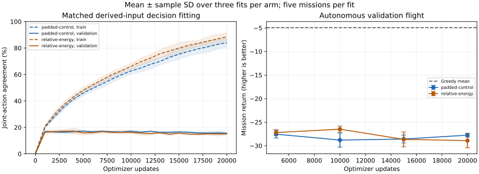
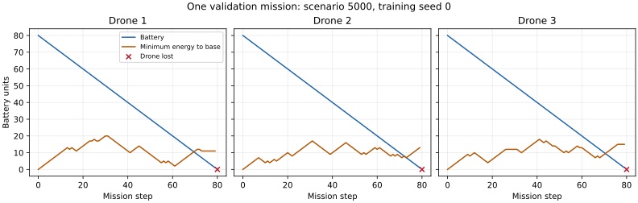

# Derived navigation/energy inputs: completed matched diagnostic

The tested derived inputs do not fix autonomous coordination. Both final arms lose the
entire fleet in 15/15 validation missions. The relative-energy arm returns −28.914 versus
−27.754 for the matched padded control, completes no charges and has lower freshness.
Training joint agreement improves to 88.49%, but validation agreement remains 15.17%.
Do not promote this input change into the RL defaults or scale it to the full grid.

## Fixed comparison

The [predeclared protocol](../../representation-protocol.md) isolates twelve derived inputs
using a new matched control. Both networks have 129,213 parameters, the original nine map
channels, 24 observation-vector values, CNN, 128 hidden units and 125 joint outputs. Each
encoder has twelve extra inputs: zeros for `padded-control`, or per-drone base-relative row,
column, normalized Manhattan distance and normalized necessary return-energy margin for
`relative-energy`. Derivation uses existing observations in the same forward path during
training and deployment. Deficits remain signed; lost-drone additions are zero.

These features add no new information, privileged oracle or action intervention. Manhattan
return energy excludes hovering and blocked-move costs, so its bound is not a safety guarantee.
The padded control differs from the preceding 24-input network in size and initialization;
historical fits are context, not extra matched replicates. Within each current seed, all
initial tensors are identical across arms. The control's zero-input weight columns stay
unchanged during fitting, as expected.

Both arms receive the same full Greedy corpus from training worlds 0–99: 15,864 real states,
3,034 critical and 8,690 charging drone states. Validation uses 800 teacher states on worlds
5000–5004, with 134 critical and 488 charging drone states. Both semantic dataset hashes match
the preceding budget study. Greedy can fail during training collection; no batteries are
restored or post-termination labels invented. Six fits use seeds 0/1/2, Adam rate 0.001,
batch size 64 uniformly sampled with replacement, norm clip 0.5 and twenty rounds of 1,000
updates with continuous optimizer/sampler state. Physics, reward and deployment action
authority are fixed; this is supervised imitation, not an RL improvement.

## Decisions and autonomous missions

Each fitted policy averages five missions before mean and sample SD over three fits.
Greedy SD is across five scenarios, a different unit. Budgets within a fit are nested,
not independent fitted models. Fleet-loss counts mean all three drones were lost.

| Updates | Padded-control return ± fit SD | Relative-energy return ± fit SD | Control fleet losses | Treatment fleet losses |
|---|---:|---:|---:|---:|
| 5,000 | −27.547 ± 0.800 | −27.194 ± 0.592 | 15/15 | 14/15 |
| 10,000 | −28.795 ± 1.502 | −26.484 ± 0.645 | 15/15 | 13/15 |
| 15,000 | −28.573 ± 0.840 | −28.651 ± 1.592 | 15/15 | 15/15 |
| 20,000 | −27.754 ± 0.397 | −28.914 ± 1.530 | 15/15 | 15/15 |
| Agreement-selected | −27.281 ± 0.626 | −27.372 ± 1.374 | 15/15 | 13/15 |
| Greedy reference | −4.922 ± 0.588 (scenario SD) | Shared reference | 0/5 | Shared reference |

The paired final treatment-minus-control return difference is −1.160 ± 1.136 over three
seed pairs. Intermediate and selected treatment flights show limited partial survival,
but almost the whole fleet is still lost and sustained inspection/recharge is absent.
Do not retrospectively promote the 10k budget as a validated best controller.

| Final metric | Padded control | Relative energy | Greedy |
|---|---:|---:|---:|
| Training joint agreement | 84.11% | 88.49% | — |
| Validation joint agreement | 15.54% | 15.17% | — |
| Validation critical-command agreement | 31.34% | 32.59% | — |
| Validation critical proposed command reduces base distance | 48.51% | 44.28% | — |
| Validation hold at base while needing charge | 92.90% | 94.26% | — |
| Autonomous weighted freshness | 0.1007 | 0.0965 | 0.3131 |
| Safe returns per mission | 0.400 | 0.400 | 3.200 |
| Completed charges per mission | 0.133 | 0.000 | 3.200 |
| Executed critical-return move fraction | 40.59% | 36.74% | 100% |

Fit fractions pool critical opportunities across the five missions before averaging fits;
the Greedy fraction pools its five reference missions. Teacher-state proposals and autonomous
executed moves are distinct. High charging-hold accuracy is insufficient when the learner
does not reliably arrive at base. Agreement measures one heuristic teacher choice, including
ties with other useful actions; it is not reward optimality.



Lines/shading and error bars show mean/sample SD over fits. Greedy is a shared scenario mean
without an uncertainty band. Selected rounds are 1/7/5 for control and 4/3/2 for treatment,
maximizing validation joint agreement among rounds 1–20 with earliest ties and initialization
ineligible. These reused validation worlds support exploratory tuning, not final
generalization, significance or universal claims that derived representations cannot help.
Final worlds 10000+ remain unused.



The example follows runner order and includes the terminal transition. Wall commands can
waste energy while staying in place and differ from collision blocks. Instrumented decision
times include recorder overhead and do not measure uninstrumented throughput.

## Integrity and reproduction

```bash
python scripts/run_representation_probe.py --out runs/representation-v8
python docs/experiments/representation-2026-10-04/archive-analysis.py
```

Install project/PyTorch dependencies and run from the repository root into a fresh output
folder; there is no resume interface. Python 3.12.14, PyTorch 2.5.1 CPU and NumPy 2.3.5 with
one Torch thread were used. Fitting, round metrics and persistence total 478.9 seconds across
six fits, excluding shared collection and autonomous evaluation; this is not a throughput
benchmark. Metadata record clean source revision `683f3481e06f7b8ddd7ad45326b43cdb0fd936d4`;
protocol hashes bind exact sources independently of remote publication commits.

All 155 missions, including five Greedy rows, are persisted and bound by `completion.json`.
Verification checks both dataset byte/semantic hashes, all 138 checkpoint byte/model/progress
identities, paired initial identity, final/selected round identities and the unchanged control
padding columns. All 155 missions replay exactly in 4,185 non-timing fields; the example
trace matches in 4,560 fields. The archive contains all 252 teacher-state metric rows, flight
rows, manifests, metadata, timings and trace. Two ZIPs preserve the original collection CSV
bytes; `collection-members.json` binds members. `archive-analysis.py` regenerates numeric
aggregation and the comparison chart; the archive manifest binds raw and derived artifacts.
Binary datasets/checkpoints remain in ignored run folders. Original RL loaders reject this
explicitly supervised format, and earlier reports/defaults remain intact.

The next correction should improve learner-relevant training experience while retaining
successful teacher return/recharge trajectories. The earlier pure-learner collection often
reached insufficient-return-energy states and supplied few successful charging examples.
Compare collection with some teacher execution against pure learner execution, record the
actual execution source, and deploy both learned policies without teacher intervention.
Do not scale the grid or compute budget until autonomous coordination improves usefully.
