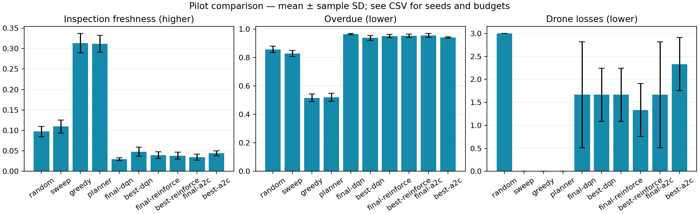
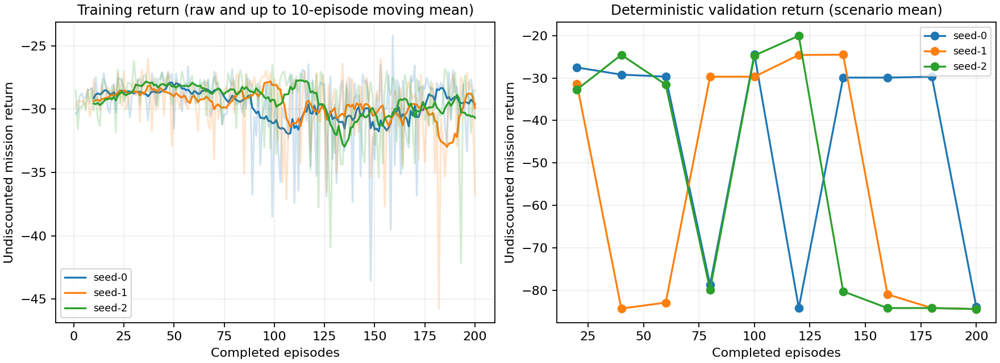
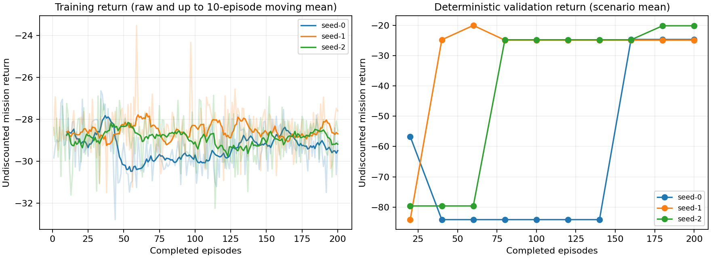
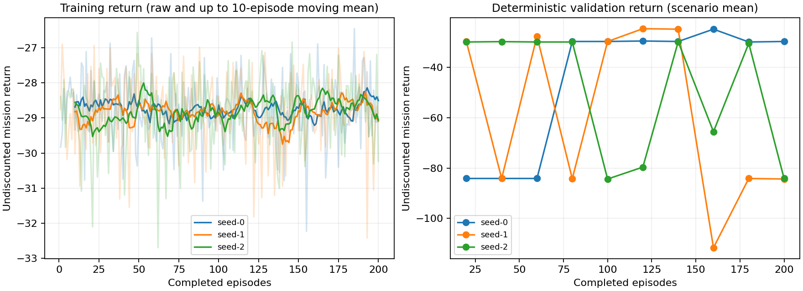

# Learning pilot: weak policies, ready experiment infrastructure

The current RL policies **do not outperform the battery-aware greedy controller** in these
validation pilots. Resume, logging and execution work; successful learning, convergence and
an RL advantage remain unproven. These results justify diagnosis and validation-only tuning,
not a paper conclusion or a change to the simulator's physical/reward rules.

## Protocol and decisions

All runs use the development 20×20 environment, horizon 160, battery 80, charge rate 5 and
125 central joint actions. Training scenarios start at 0; validation scenarios are 5000–5004.
The planner budget is horizon 3, eight candidates and two independent samples. No learned
policy has an action mask or battery-return shield. Greedy/sweep/planner have their own
battery-aware proposal rules. The fire parameters remain illustrative and uncalibrated.

1. The original architecture trained 80 episodes with training seed 0. Mean validation returns
   were DQN −59.907, REINFORCE −35.460 and A2C −79.599, versus greedy −4.922 and planner
   −5.024. Inspection freshness was low; DQN/A2C showed repeated blocked actions and
   REINFORCE lost all three drones on each validation mission. Untrained policies were also
   poor. [Raw original rows](experiments/original80-validation.csv) preserve the controls.
2. Version 2 explicitly marks observed drone/base positions in the CNN input and adds an
   optional Monte Carlo baseline to REINFORCE. Both changes are independently ablatable;
   changing both together does not identify which caused a difference. The environment,
   reward, learning rate, horizon and episode budget stayed fixed for the revised 80-episode
   run. [Revised rows](experiments/revised80-validation.csv) contain final, selected and
   untrained spatial-network controls. Final returns were DQN −78.602, REINFORCE −84.109 and
   A2C −29.696. The selected DQN checkpoint scored −27.525, still much worse than greedy.
   The representation change is an experiment choice, not a demonstrated improvement.
3. The revised version then trained **200 episodes independently for seeds 0, 1 and 2** for
   each method (nine fits), validating every 20 episodes. Selection maximises scenario-mean
   validation return; final policies are retained separately. The summary below reports
   all 110 final/selected/baseline scenario rows. Larger compute has not been assumed to
   solve the repeated-command/charging problem.

## Repeated 200-episode validation

| Policy | Mean return ± SD | Mean freshness | Mean drone losses | Mean blocked attempts |
|---|---:|---:|---:|---:|
| random | -28.337 ± 0.797 | 0.097 | 3.00 | 2.6 |
| sweep | -12.142 ± 0.499 | 0.110 | 0.00 | 0.0 |
| greedy | -4.922 ± 0.588 | 0.313 | 0.00 | 0.0 |
| planner | -5.024 ± 0.656 | 0.312 | 0.00 | 0.0 |
| final-dqn | -84.145 ± 0.330 | 0.030 | 1.67 | 302.7 |
| best-dqn | -22.998 ± 2.537 | 0.048 | 1.67 | 0.0 |
| final-reinforce | -23.269 ± 2.671 | 0.040 | 1.67 | 0.0 |
| best-reinforce | -21.651 ± 2.638 | 0.038 | 1.33 | 0.0 |
| final-a2c | -66.047 ± 31.481 | 0.035 | 1.67 | 213.3 |
| best-a2c | -26.390 ± 2.914 | 0.044 | 2.33 | 0.0 |

RL mean returns first aggregate five scenarios within each fitted model; SD is across three
fitted seeds. Baseline SD is across five scenarios. These are different uncertainty units,
not confidence intervals or significance tests. Freshness is in [0, 1]; losses count drones;
blocked attempts count individual drone proposals over a mission. Quality uses the full
horizon, including an unserved remainder after fleet loss. All best-policy scores use the
same validation scenarios for selection and reporting, so they are selection-biased.

Selected episode boundaries (no final-test selection):

- dqn: selected episodes 100, 140, 120 for training seeds 0, 1, 2.
- reinforce: selected episodes 160, 60, 180 for training seeds 0, 1, 2.
- a2c: selected episodes 160, 120, 40 for training seeds 0, 1, 2.

## Learning and failure diagnosis

Stochastic training returns remain near random-control performance. Deterministic argmax
validation often repeats one poor joint action, causing stationary fleets, collisions or
battery loss. Higher return on one intermediate checkpoint does not demonstrate sustained
inspection/recharge scheduling. Logging now records freshness, collision attempts, safe
returns, completed charges and losses, in addition to return and value loss.

These plots show each fitted seed separately; training lines are raw returns plus up to a
10-episode moving mean. Validation lines average the five fixed scenarios. A2C's last
rollout value loss is diagnostic, not an episode-average critic error. No training score is
substituted for held-out generalisation.

## Next experiment and limits

The [Colab notebook](../notebooks/colab_experiments.ipynb) extends the 20×20 study to 1,000 total
episodes per method/seed, benchmarks CPU/CUDA, checks actual CUDA updates and resumption,
and stores episode-boundary states in Drive. Run sections 1–6 and 8, then return the results
archive. This workspace has no GPU: CUDA tests are skipped locally and require that runtime.
The NumPy simulator is serial CPU code, so a GPU speedup must be measured.

Use validation to assess learning rate/entropy, exploration and spatial/Monte Carlo-baseline
ablations before adding complexity. Do not change reward or constraints merely to obtain
an RL win. Assess stochastic evaluation as a separately declared policy choice; the present
comparison uses deterministic argmax. Battery/charge/fire sensitivity and reward/constraint
ablations, frozen repeated held-out evaluation, and calibrated simulator validation remain
research work. The notebook's 40×40 experiment is explicitly opt-in and trains a new model;
it is not cross-domain transfer. Final 20×20 seeds 10000+ remain unused by this pilot.

[Raw repeated rows](experiments/repeated200-validation.csv),
[protocol](experiments/repeated200-protocol.json) and
[run manifest](experiments/pilot-manifest.json) record budgets, model choices and provenance.
The pilots ran in a dirty implementation checkout, recorded transparently in metadata;
this limits exact source provenance. Later changes in this PR add source histories and
resume preflight checks. Repeat results from the merged revision for a final study. Original
binary replay/policy snapshots stay outside Git; the committed CSVs retain the diagnostics.
